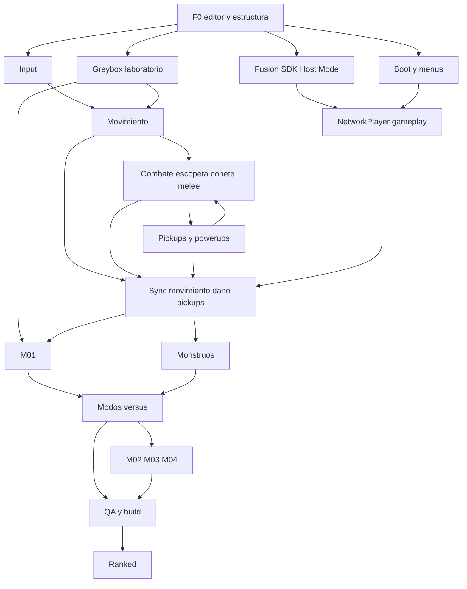
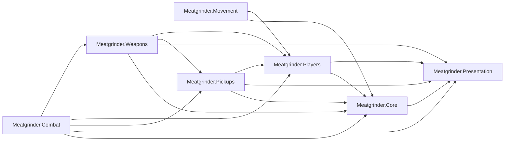
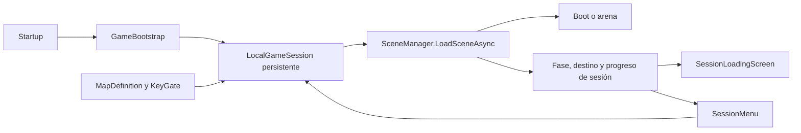

# Grafo de dependencias — juego completo

Fecha: 24 de noviembre de 2026.
Detalle por tarea: [MASTER_CHECKLIST.md](MASTER_CHECKLIST.md). Plan: [FULL_GAME_DEVELOPMENT_PLAN.md](FULL_GAME_DEVELOPMENT_PLAN.md).

Las flechas significan «hace falta antes». Ranked y ampliaciones están **en el grafo** con prioridad baja; no están fuera del producto.

## Cadena de sistemas

## Camino crítico P0 → P1

1. Asmdefs limpios (`IDamageModifiers` / sin ciclo Combat↔Pickups).
2. F2-08 lanzacohetes cableado al jugador.
3. F6-01/02/03 pickups con efecto real; Quad → DamageResolver.
4. F2-13 melee; F2-14 Berserk.
5. F2-04 respawn local.
6. F0-08 Boot → F7-01/02 menú → F3-01 bootstrap producto.
7. F3-03 NetworkPlayer → F3-04/06/07 sync → F3-12 dos clientes gameplay.
8. F5-02 M01 blockout en paralelo seguro (escena nueva).

## Ensamblados (integración local, 22 noviembre)

`Combat` no debe referenciar `Pickups`. Los modificadores de daño se inyectan vía `IDamageModifiers`.

`GameBootstrap` reutiliza una sola sesión local persistente. `Startup` solicita Boot y los menús solicitan las arenas, el reinicio y el retorno a Boot. Abrir Boot o un mapa directamente en el Editor sigue siendo válido. `MapDefinition` identifica la escena y `MapRouteState` conserva las llaves del mapa. `KeyGate` solicita la carga de la arena siguiente.

`Core` controla la activación de la escena y el bloqueo de controles durante la fase de carga. `Presentation` lee la fase, el destino y el progreso de `AsyncOperation`. `GameUi` comparte los roles tipográficos entre el menú, el HUD y la pantalla de carga. Las vistas solicitan operaciones a la sesión y leen estado de juego. El ensamblado `Core` conserva su independencia de `Presentation`.

`LifeTuning`, `MeleeTuning`, `WeaponDefinition`, `PickupDefinition` y `PresentationTheme` están serializados en prefabs/escenas. `PlayerLife` coordina un único ciclo de muerte; `PlayerVoidFall` resuelve el daño ambiental mediante `DamageResolver`. Las animaciones, audio, HUD y efectos no aplican daño. La sesión actual es local: falta conectar estas operaciones a autoridad Fusion antes de uso competitivo.

## Integración local verificada — 22 de noviembre de 2026

La rama local ya conecta `PlayerCombat` → `DamageResolver` → `HealthComponent` para escopeta,
cohete, melee y daño de vacío. `PowerUpManager` inyecta los modificadores en el mismo resolver;
`PlayerLife` coordina muerte, inventario, `DeathLoot`, respawn seguro y protección inicial;
`PlayerMovement` recibe sprint/agacharse e impulsos de rocket jump. Estas conexiones son locales y
autoritativas en una sola máquina: no representan todavía sincronización Fusion ni dos clientes reales.

## Paralelo seguro vs coordinación

| Paralelo | Coordinar |
|---|---|
| Fichas monstruo (docs), audio placeholder, UI menú sin combate, blockout M01 en escena nueva | DamageResolver, PowerUpManager, LocalPlayer prefab, asmdefs, Fusion spawn |

## Ranked y ampliaciones

E11 (R-01…R-04) cuelga del núcleo jugable + autoridad + decisión de backend. Sigue REQUIRED (P4).
E12 (P-01…P-07) REQUIRED con P3–P4. No bloquean P0.
M02–M04 y 4v4: REQUIRED; orden tras M01 y matriz de red.
