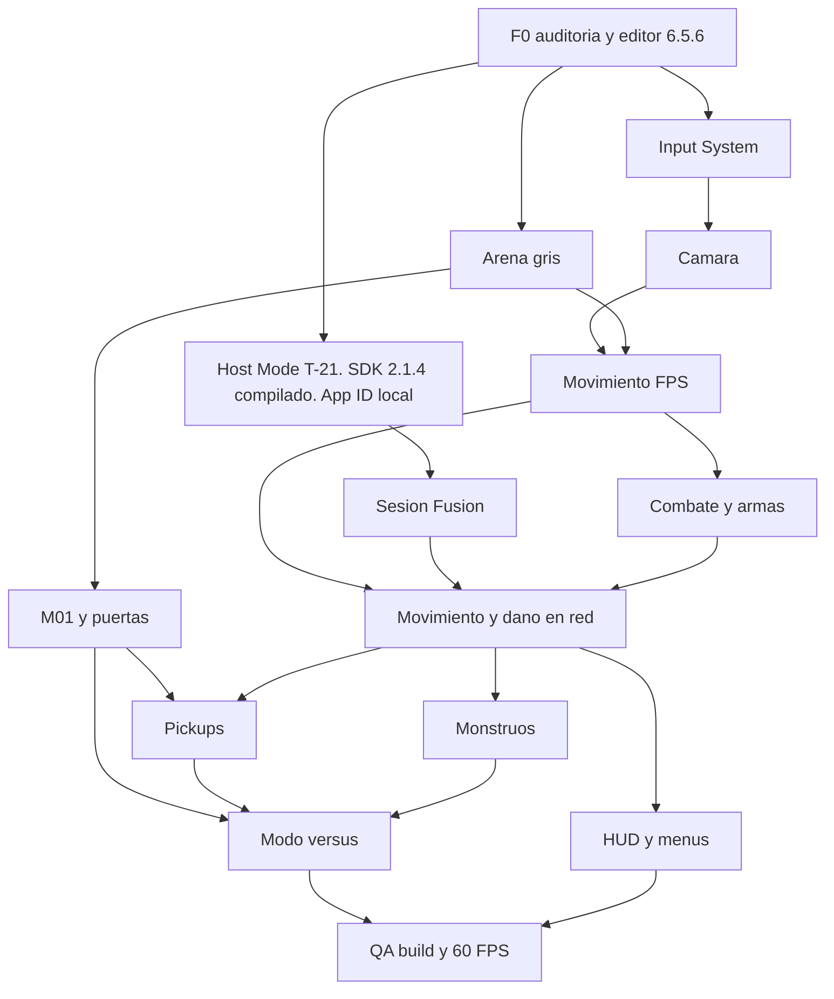

# Grafo de dependencias

Fecha: 2 de noviembre de 2026.
Las flechas significan «hace falta antes». El detalle por tarea está en [MASTER_CHECKLIST.md](MASTER_CHECKLIST.md).

## Cadena de sistemas

Esa cadena es la que pide el encargo, aterrizada en el GDD: controlador, cámara, input, movimiento, combate, red, modo versus. Los monstruos y los ítems entran cuando el daño ya es autoritativo. El arte final no está en la cadena crítica.

## Camino crítico del MVP

1. F0-02 y F0-03 están hechas: Unity 6000.5.6f1 abrió `grinder/` y la plantilla compiló.
2. F0-05 y F0-06 están hechas: Host Mode y Fusion 2.1.4 Stable, build 2500, compilado. El App ID está en el asset local.
3. El movimiento local puede prepararse en paralelo.
4. F0-07 estructura y F5-01 arena gris.
5. F1-01 a F1-10 movimiento comprobable.
6. F2-01, F2-02, F2-06, F2-07, F2-08 daño y las dos armas en local.
7. F0-08 escena Boot antes de F3-01. El App ID ya está en el asset local.
8. F3-02 está hecha con la sonda de `NetworkTest`. Siguen F3-01 (Boot), F3-03 (arena), F3-04, F3-07 y F3-10.
9. F3-12 dos clientes.
10. F7-04 y F7-05 HUD mínimo.
11. F3-14 una pasada de latencia, aunque el umbral siga sin número.

El SDK compiló, el App ID está en el asset local y la sonda Host/Client del 3 de noviembre de 2026 conectó dos procesos. El movimiento local ya no está bloqueado por la red. F3-01 sigue esperando la escena Boot.

## Qué puede ir en paralelo

| Mientras tanto | Se puede adelantar | No se puede adelantar |
|---|---|---|
| El App ID ya está en el asset local | F0-04, F0-11 y el movimiento local después de F0-07 | Commitear `PhotonAppSettings.asset`, importar la demo Shared, cambiar a Shared Mode |
| F1 movimiento local | F2-01 y F2-02, que no necesitan cámara; fichas de diseño D-07, D-10, D-12 | F3-04, porque necesita el movimiento ya probado |
| F2 armas en local | Blockout F5-01; modelo humano F8-02 si la licencia ya está | Proyectil en red F3-08 |
| F3-12 dos clientes locales | UI de menú F7-01, si D-09 está cerrada | Matriz de LAN F3-13, 4v4, M02 |
| M01 en blockout | Materiales F8-01 | Intercambio de roles F9-04, hasta F9-01 |

F8, el kit visual y la música, quedan fuera del camino crítico por la regla de corte del GDD: si el calendario aprieta, se recorta arte antes que las pruebas de red.

## Bloqueos que no son de código

Estas tareas están `BLOCKED` porque falta una decisión o una herramienta, no porque falte una tarea previa de implementación:

- F0-02 y F0-03 quedaron cerradas el 3 de noviembre de 2026.
- F0-05 y F0-06 quedaron cerradas el 3 de noviembre de 2026. El App ID está en el asset local. F3-01 espera F0-08.
- F0-10: PC de referencia.
- F1-11: dash.
- F2-03 y F6-02: fórmula de armadura.
- F3-02 quedó cerrada el 3 de noviembre de 2026 con la sonda de `NetworkTest`. F3-01 sigue esperando la escena Boot. F3-03 espera la arena gris.
- F3-09: lag compensation.
- F4-02 y F4-06: fichas de monstruo y armas de monstruo.
- F6-03, F6-04 y F6-06: Quad Damage, temporizadores y acumulación.
- F9-01: modo de la demo.

## Fuera del grafo de la demo

E11 Ranked cuelga de F10-08 y de una aprobación nueva. No tiene arista hacia el MVP.
E12 son propuestas. No bloquean ninguna tarea P0.
M02 (F5-09) y 4v4 (F9-06) cuelgan de la matriz de red y del rendimiento. Si se retrasan, salen de la demo sin romper M01.
